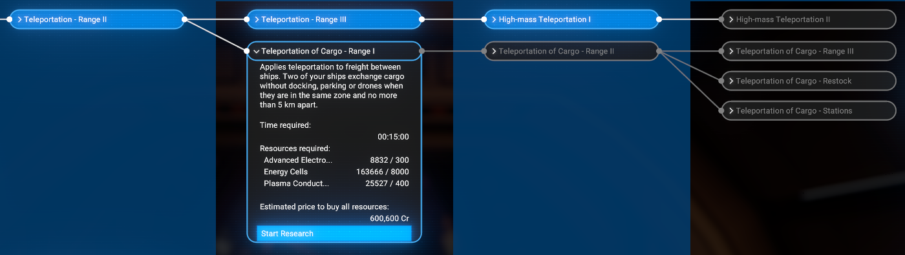
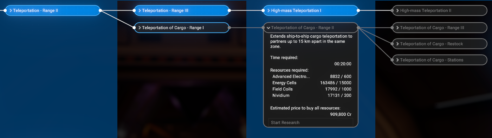
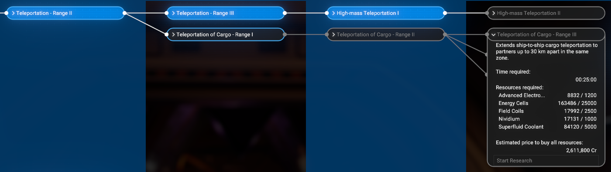
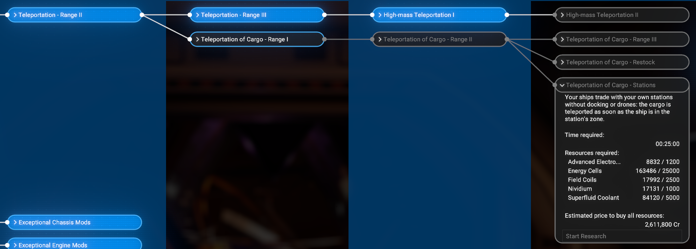
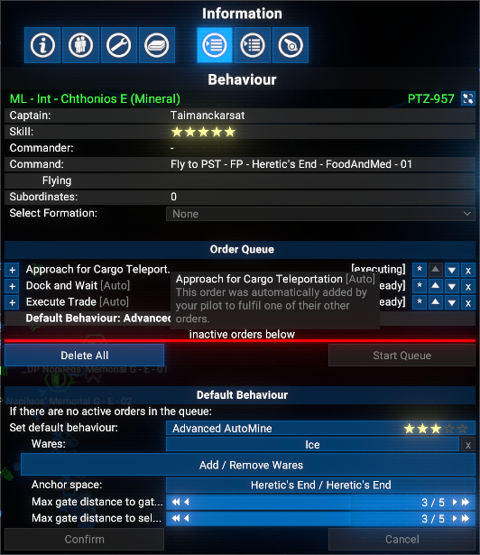
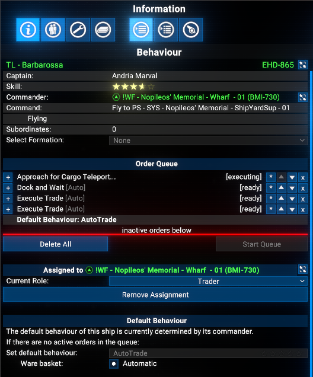
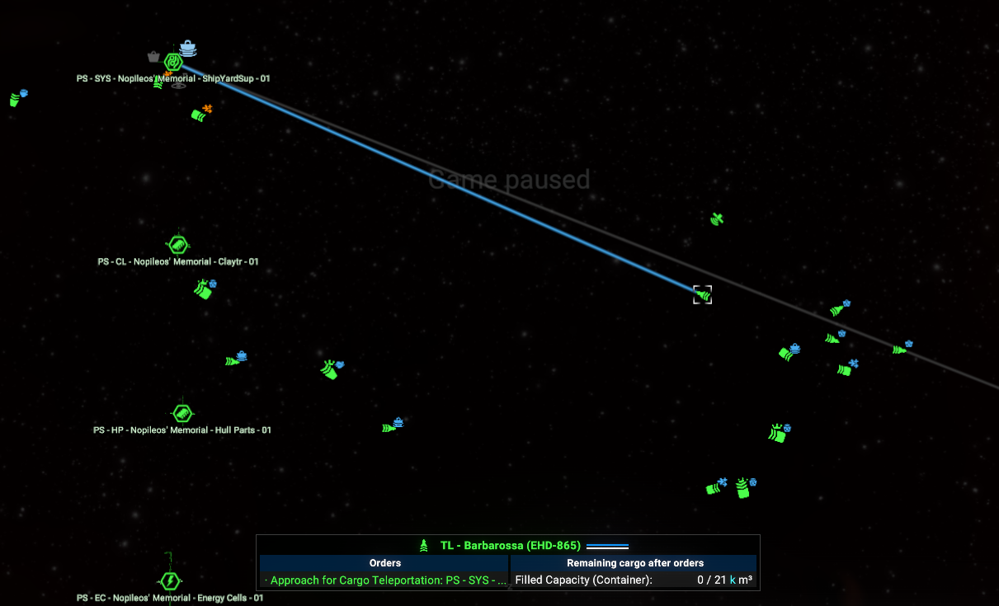
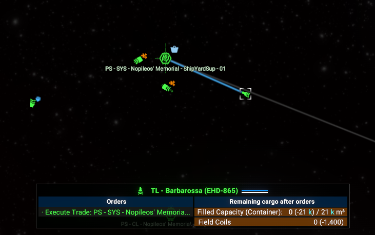
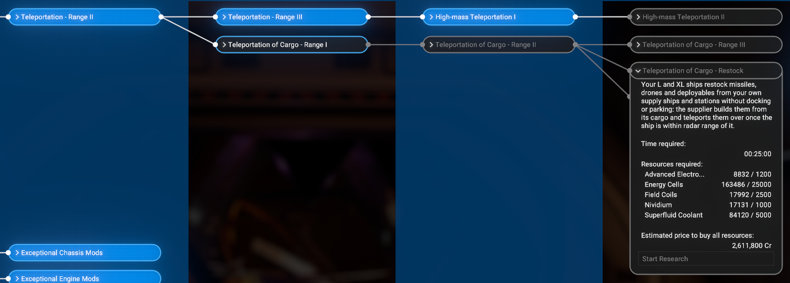
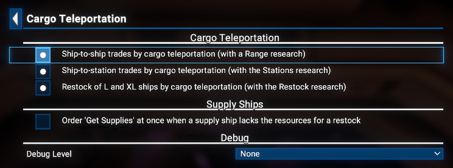

# Cargo Teleportation

Capital ships waste minutes queueing for a pier just to hand over cargo to a station you own. This extension adds five research projects that extend the teleportation line to freight: your own L and XL ships exchange cargo with each other and with your stations where they are, without docking, and restock from your own supply ships and stations the same way.

## Features

- **Teleportation of Cargo - Range I** research, available after **Teleportation - Range II**: a ware exchange between two of your L or XL ships happens without docking or parking once they are within 5 km of each other.
- **Teleportation of Cargo - Range II** and **Range III**: the same up to 15 km and 30 km.
- **Teleportation of Cargo - Stations** research, available after **Teleportation of Cargo - Range II**: every trade between your own L or XL ship and your own station happens without docking as soon as the ship is near enough to the station. Your existing traders and miners use it on their own, with no new orders.
- **Teleportation of Cargo - Restock** research, available after **Teleportation of Cargo - Range II**: when one of your L or XL ships restocks missiles, drones or deployables from your own supply ship or station, it gets the **Restock by Cargo Teleportation** order instead of docking or parking: it moves within radar range of the supplier, waits while the supplier builds the items from its cargo, and receives them by teleportation. The wait is a few seconds plus a fifteenth of the normal build time, at most two minutes for an XL ship and one minute for an L ship.

## Limitations

- L and XL ships only: S and M ships trade, dock and restock as usual.
- Only trades in which both sides are yours. Trades with other factions dock as usual.
- Both sides must be near enough to each other for the game to count them in one area, which it calls a zone. Ships fly close to the partner first; for a ware exchange they then close in to the researched range.
- The ship or its partner still needs at least one cargo drone, as the game requires for any capital ship trade.
- A ware exchange that cannot complete this way falls back to parking as usual.
- The ship you are piloting yourself is left out.
- A restock by teleportation needs your own supply ship or station that already holds all the resources for the items; otherwise the game's usual restock runs. The game picks the supplier as usual: an own station only when the restock goes there, for example with the **Resupply** order at that station.
- The extension patches four game AI scripts: `order.trade.perform.xml`, `order.dock.wait.xml`, `order.trade.wareexchange.ship.xml` and `interrupt.restock.xml`. The patches are small and placed with care, but another mod that patches or replaces the same scripts can still conflict with it.

## Requirements

- **X4: Foundations**: Version **8.00** or higher, Windows version.
- **Mod Support APIs**: Version **1.95** or higher by [SirNukes](https://next.nexusmods.com/profile/sirnukes?gameId=2659).
  - Available on Steam: [SirNukes Mod Support APIs](https://steamcommunity.com/sharedfiles/filedetails/?id=2042901274)
  - Available on Nexus Mods: [Mod Support APIs](https://www.nexusmods.com/x4foundations/mods/503)
- **Options Helper**: Version **1.10** or higher by [Chem O`Dun](https://next.nexusmods.com/profile/ChemODun/mods?gameId=2659).
  - Available on Steam: [Options Helper](https://steamcommunity.com/sharedfiles/filedetails/?id=3715253556)
  - Available on Nexus Mods: [Options Helper](https://www.nexusmods.com/x4foundations/mods/2155)
- **Print Extension List**: Version **1.00** or higher by [Chem O`Dun](https://next.nexusmods.com/profile/ChemODun/mods?gameId=2659).
  - Available on Steam: [Print Extension List](https://steamcommunity.com/sharedfiles/filedetails/?id=3770927339)
  - Available on Nexus Mods: [Print Extension List](https://www.nexusmods.com/x4foundations/mods/2191)

## Installation

You can download the latest version via Steam client - [Cargo Teleportation](https://steamcommunity.com/sharedfiles/filedetails/?id=3822127190)
Or you can do it via the Nexus Mods - [Cargo Teleportation](https://www.nexusmods.com/x4foundations/mods/2465)

## Save state

**No** (removing the extension does not break saves).

## Usage

Research **Teleportation - Range II** at your headquarters, then **Teleportation of Cargo - Range I**. From then on a ware exchange between two of your L or XL ships uses it on its own: one ship holds its position, the other comes into range and the cargo changes hands.

**Range II** and **Range III** extend it to partners up to 15 km and 30 km apart.

After **Range II**, research **Teleportation of Cargo - Stations**: every trade order between your own L or XL ship and your own station then uses it too: the ship flies near enough to the station and the cargo changes hands there.

The pilot adds the **Approach for Cargo Teleportation** order on its own in front of the trade, so the order queue shows where the ship is heading:

On the map the ship flies only near enough to its partner, not to a dock:

Once it is near enough, the ship runs its trade from where it is and the cargo is teleported:

Research **Teleportation of Cargo - Restock** after **Range II** as well, and your L and XL ships that restock from your own supply ship or station stay in open space: the supplier builds the missiles, drones and deployables and teleports them over. When something prevents it, the ship docks or parks as usual.

## Options

An options page is available via the `Extension Options` menu:

## Credits

- Author: Chem O`Dun, on [Nexus Mods](https://next.nexusmods.com/profile/ChemODun/mods?gameId=2659) and [Steam Workshop](https://steamcommunity.com/id/chemodun/myworkshopfiles/?appid=392160)
- *"X4: Foundations"* is a trademark of [Egosoft](https://www.egosoft.com).

## Acknowledgements

- [EGOSOFT](https://www.egosoft.com) - for the X series.
- [SirNukes](https://next.nexusmods.com/profile/sirnukes?gameId=2659) - for the Mod Support APIs that power the UI hooks.

## Changelog

### [1.00] - 2026-10-18

- **Added**
  - Initial public version
